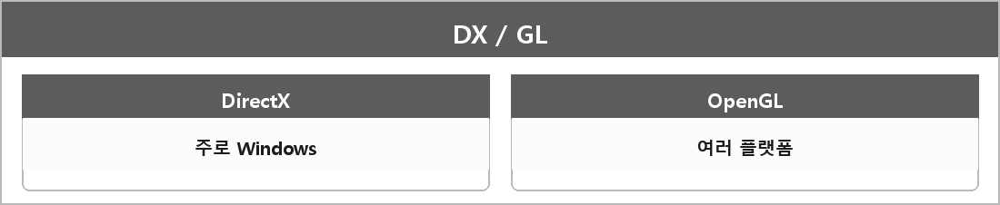

# DirectX vs OpenGL

  

> DirectX는 주로 윈도우 전용 API이고, OpenGL은 다양한 플랫폼에서 동작하는 범용 그래픽스 API다.

Vulkan은 더 저수준. 내가 API 예에 적어 둔 그거.

---

> [!WARNING]
> **더 보충이 필요한 부분**
>
> 좌표계, 텍스처 원점, 셰이더 언어(HLSL vs GLSL) 차이는 한 줄에 안 들어 있다.
> 포팅을 말하면 그 세 개가 바로 나온다. Khronos OpenGL spec / Microsoft D3D 문서.
