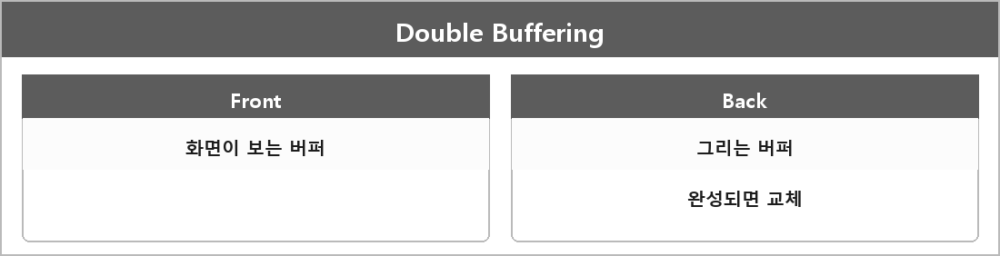

# 더블 버퍼링

  

> 화면 출력용 프런트 버퍼와 그릴 때 사용하는 백 버퍼 두 개를 사용하는 방식. 동작 방법은 GPU가 새 버퍼에 그림을 그리고 완성되면 프론트 버퍼와 교체 그리고 다시 새로운 그림을 준비하는 방식. 장점은 화면 깜빡임과 티어링 감소, 단점은 GPU의 버퍼 교체가 늦으면 입력 지연이 발생.

> [!TIP]
> **여담**
>
> 더블 버퍼링은 프런트 버퍼와 백 버퍼 두 개를 교체해 사용해 화면 깜빡임을 줄이는 기법이다.
>
> 벽돌깨기 화면이 깜빡이면 이쪽을 의심한다. WinAPI에서 전면 버퍼에 바로 그리면 그리는 중간이 보인다.
>
> 트리플 버퍼링은 버퍼가 3개라 더 부드러울 수 있지만 메모리를 더 쓴다.
