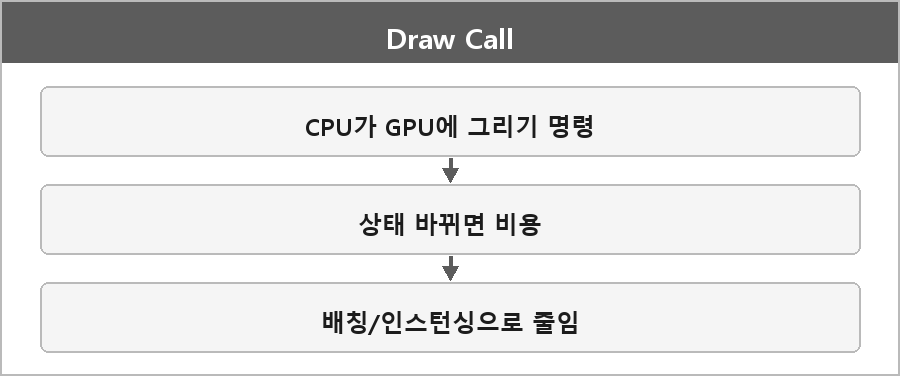

# Draw Call

  

> Draw Call은 CPU가 GPU에 그리기 명령을 내리는 호출이고, 배칭·인스턴싱·상태 변경 최소화로 줄여 성능을 높일 수 있다.

유니티 디버깅할 때 DirectX에서 배운 드로우콜 개념으로 최적화 원인을 파악하는 데 도움이 됐다.

상태(셰이더, 텍스처, 버퍼)를 바꿀 때마다 비용이 붙는다. 같은 상태로 여러 메시를 한 번에 그리는 게 배칭이다.
