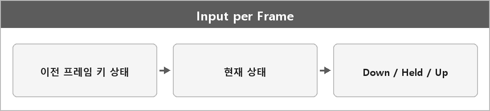

# 입력

  

> 프레임 단위로 갱신하는 이유는 로직이랑 렌더링이 같은 시점의 입력 상태를 사용하게 되기 때문에 그리고 이전 프레임 상태와 비교하여 키 누름/뗌을 정확하게 하여 누락이나 불일치를 방지하기 위해.

> [!TIP]
> **여담**
>
> 고급지게 말하는 버전.
> 키보드나 마우스 입력은 OS 이벤트만으로는 '누르는 순간', 누르고 있는 중, 떼는 순간을 구분하기 어려워,
> 프레임 단위로 상태를 관리해야 게임 로직에서 정확한 반응을 구현할 수 있기 때문에.
