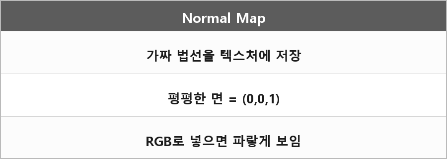

# 노말맵

  

> 노말맵은 표면의 요철을 가짜 법선으로 표현해 디테일을 주는 텍스처이고, 기본 법선이 Z축(0,0,1)이라 색으로 인코딩하면 파란색을 띤다.

지오메트리를 안 쪼개고 픽셀 법선만 흔들어서 조명 반응을 바꾸는 거다.
레이트레이싱이랑 차이: 노말맵은 로컬 셰이딩 속임수, 레이트레이싱은 광선을 실제로 추적.

---

> [!NOTE]
> **보충**
>
> 탄젠트 공간 노말맵에서 평평한 면의 법선은 (0,0,1).
> RGB에 0.5 바이어스해서 넣으면 R=128, G=128, B=255에 가까워서 파랗게 보인다.
> Unity/Unreal 매뉴얼의 Normal mapping이 이 설명이다.
