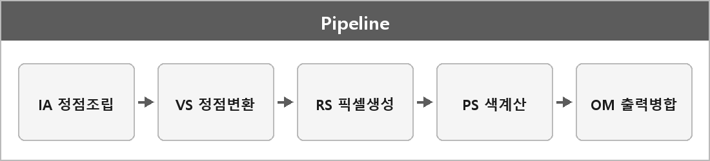

# 렌더링 파이프라인 (IA, VS, RS, PS, OM)

  

> 3D 모델 데이터를 화면의 2D 그림으로 바꾸는 과정이다.
> 정점을 받아서 화면에 맞게 변환하고, 픽셀 색을 계산해서 최종 이미지를 만든다.

파이프라인은 작업을 여러 단계로 나눠 순차 처리하는 구조다.
그래픽스에선 정점 처리부터 픽셀 출력까지 이어지는 렌더링 과정 전체를 말한다.

DirectX에선 주로 IA → VS → RS → PS → OM을 거친다.

## 단계

| 단계 | 이름 | 하는 일 |
| --- | --- | --- |
| **IA** | 입력 조립기 | 정점 데이터를 가져와 렌더링에 쓸 기초 데이터를 준비 |
| **VS** | 정점 셰이더 | 정점 위치 변환. 모델 좌표 → (클립 쪽) 변환 |
| **TS** | 테셀레이터 | 저폴리곤을 고폴리곤으로 더 쪼갬 |
| **GS** | 지오메트리 셰이더 | 점/선/삼각형 단위로 타입 변경 |
| **RS** | 래스터라이저 | 정점 → 픽셀. 그릴 영역, 클리핑, 뷰포트 |
| **PS** | 픽셀 셰이더 | 색, 조명, 텍스처. 최종 픽셀 색 |
| **OM** | 출력 병합기 | 깊이 테스트, 블렌딩. 합쳐서 최종 이미지 |

> [!TIP]
> **쉽게 말하기**
>
> 1. IA — 정점 데이터 모으고
> 2. VS — 꼭짓점을 변환하며
> 3. RS — 픽셀을 생성한다.
> 4. PS — 픽셀 색을 결정하고
> 5. OM — 최종적으로 합쳐져 출력된다.

---

> [!NOTE]
> **보충**
>
> - **출처:** Microsoft Learn — Graphics Pipeline (Direct3D 11)
>
> D3D11 단계 이름은 IA / VS / HS / DS / GS / RS / PS / OM 이다.
> 테셀레이션은 HS + DS (+ TS 하드웨어)로 문서에 나와 있다. 내가 TS라고 묶은 부분.
>
> VS가 "모델 좌표를 화면 좌표로"는 한 번에 다 하는 게 아니다.
> 보통 월드/뷰/투영까지 클립 공간이고, 화면 픽셀은 래스터라이저/뷰포트 담당이다.
> 단계 경계는 `View-Projection.md`, `Viewport.md`랑 같이 보면 된다.
