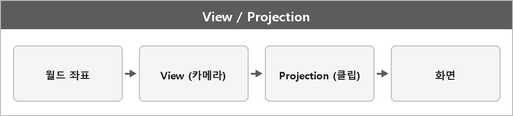

# View / Projection 행렬

  

> View 행렬 카메라의 위치와 방향을 기준으로 월드 좌표를 카메라 좌표계로 변환하는 행렬. 즉, 카메라가 보는 시점으로 장면을 바꿔준다.

Projection 행렬
3D 좌표를 2D 화면 좌표로 변환하는 행렬이다.
원근 투영 그러니까 멀리 있는 건 작게 보여주거나 또는 직교 투영 그러니까 크기 변동이 없게 보여주는 것 등을 적용한다.

> [!TIP]
> **여담**
>
> View는 카메라 위치와 방향을 적용해 월드→카메라 좌표로, Projection은 투영 방식을 적용해 카메라→클립 공간 좌표로 변환한다.
>
> Perspective는 거리에 따라 크기가 달라져 깊이감을 주고, Orthographic은 거리에 상관없이 크기가 같아 평면적으로 표현된다.

---

> [!NOTE]
> **보충**
>
> - **출처:** Microsoft Learn — XMMatrixLookAtLH
> 반환값은 "world space를 view space로 바꾸는 뷰 행렬"이다.
>
> 원 정리에 `XMMatrixLookAtLH : 카메라 좌표계 → 월드 좌표계`라고 적혀 있는데, 방향이 반대다.
> LookAtLH는 월드 → 뷰(카메라)다.
> 월드로 다시 가려면 그 행렬의 역변환이다.
>
> `XMMatrixOrthographicOffCenterLH`는 지정한 박스 영역을 평행 투영하는 행렬이 맞다. 같은 DirectXMath 문서.
