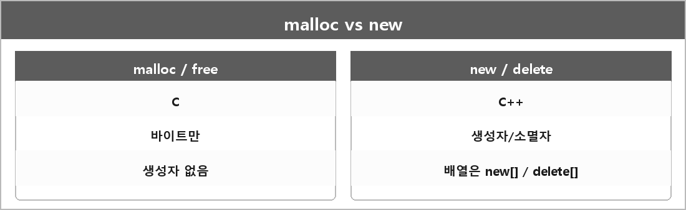

# new / delete 와 malloc / free

  

> new/malloc은 할당, delete/free는 해제다. 섞으면 안 된다. new로 받은 걸 free하거나 malloc으로 받은 걸 delete하면 UB에 가깝다.

차이:
- malloc/free: C 표준 라이브러리. 바이트만 준다. 생성자가 안 불린다.
- new/delete: C++ 표현식. 할당 후 생성자를 호출하고, delete는 소멸자 후 해제한다.
- new[] / delete[]: 배열. 개수만큼 생성자/소멸자.

---

> [!NOTE]
> **보충**
>
> - **출처:** 
> - ISO C malloc/free: ISO/IEC 9899 7.24.3 (또는 C17 7.22.3)
> - C++ new/delete: [expr.new], [expr.delete]
> new가 실패하면 기본적으로 std::bad_alloc을 던진다. malloc은 nullptr을 돌려준다.

---

> [!WARNING]
> **더 보충이 필요한 부분**
>
> placement new, operator new 오버로드, 커스텀 할당자는 정리에 없다.
> 메모리 풀이랑 연결하려면 placement new가 필요하다.
> 이유는 풀에서 받아 온 메모리에 생성자를 호출해야 해서다. 필요하면 [expr.new] placement 절만 추가하면 된다.
