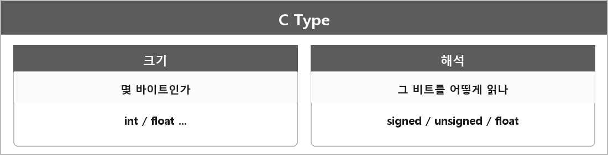

# C언어의 타입

  

> C언어의 타입은 크게 두 가지를 가지고 있다. 하나는 크기, 메모리를 얼마나 먹는가. 둘째는 해당 비트들을 어떻게 읽을 것인가. 즉, 해석 방식.

같은 4바이트라도 signed int로 읽는지, unsigned int로 읽는지, float로 읽는지에 따라 값이 달라진다.
타입이 크기만 정하는 게 아니라 그 비트를 어떤 규칙으로 해석할지도 같이 정한다.

---

> [!NOTE]
> **보충**
>
> - **출처:** ISO/IEC 9899 (C 표준) 6.2.5 Types.
> 표준은 타입을 "객체에 담긴 값의 의미와, 그 값에 할 수 있는 연산"으로 본다.
> 내가 말한 크기 + 해석 방식이 그 문장을 내가 쓰는 말로 줄인 거다.
>
> char가 signed인지 unsigned인지는 구현체 정의다.
> - **출처:** ISO/IEC 9899 6.2.5, 그리고 C++이랑 같이 보면 [dcl.type.simple] / implementation-defined.
> 예시는 Implementation-Defined-Behavior.md에 적어뒀다.
