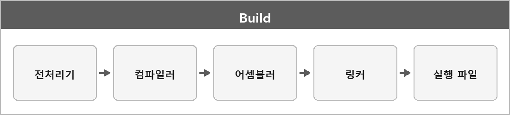

# 빌드

  

> 컴파일, 링크 등의 과정을 포함하여 최종 실행 파일 혹은 배포 가능한 형태로 만드는 과정 전체를 의미한다.

빌드 과정
전처리기 -> 컴파일러 -> 어셈블러 -> 링커 -> 프로그램

런타임 과정
실행 -> 운영체제 로더 -> 메모리 적재 -> 실행됨

전처리기: `#include`, `#define` 같은 걸 펼친다.
컴파일러: 소스/전처리 결과를 어셈블리 또는 목적 코드로 바꾼다.
어셈블러: 어셈블리를 오브젝트 파일로 바꾼다.
링커: 오브젝트들이랑 라이브러리 심볼을 묶어서 실행 파일을 만든다.

main은 운영체제가 직접 호출하는 게 아니라, 실행 시 로드된 CRT 초기화 코드가 준비 작업을 마친 뒤 main을 호출한다.
main이 끝나면 반환값은 OS에 전달되고 종료 루틴이 실행된다.
이 부분은 CRT-Main.md에 있다.
