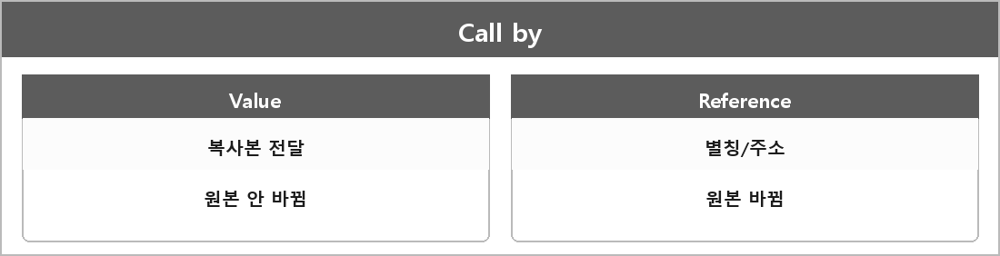

# Call by Value / Call by Reference

  

---

## CallByValue

함수에 인자를 전달할 때 원본 값의 복사본을 넘기는 방식이다.
함수 내에서 해당 인자를 변경하더라도 원본 데이터에는 영향을 미치지 않는다.
데이터 보호 측면에선 안전하지만, 큰 데이터를 복사해야 하면 비용이 커진다.

---

## CallByReference

함수에 원본 데이터의 참조나 주소를 넘기는 방식이다.
함수 내에서 인자를 변경하면 원본 데이터도 같이 변경된다.
복사 비용은 없는데 원본이 바뀐다.
C++에선 참조(`&`) 또는 포인터로 구현한다.
원본을 수정할 필요가 있을 때 쓴다.

> [!TIP]
> **여담**
>
> 흔히들 말하는 깊은 복사 얕은 복사가 이거다.
> 깊은 복사는 값을 통째로 복사해서 독립된 데이터를 만들기 때문에 원본에 영향을 안 주고
> 얕은 복사는 메모리 주소로 복사를 하기 때문에 원본에 영향이 간다.
>
> 얕은 복사: 포인터 주소만 복사해 원본과 복사본이 메모리를 공유한다.
> 깊은 복사: 데이터 자체를 새로 복사해 독립적인 객체를 만든다.

---

> [!WARNING]
> **더 보충이 필요한 부분**
>
> Call by Value/Reference랑 얕은/깊은 복사를 같은 여담으로 묶으면 면접에서 섞인다.
> - 인자 전달 방식: 복사해서 주느냐, 별칭/주소를 주느냐
> - 복사 깊이: 객체 안에 포인터가 있을 때 그 포인터만 복사하느냐, 가리키는 데이터까지 새로 만드느냐
>
> 이 둘은 겹치는 부분이 있어도 질문이 다르다.
> C++ 표준은 "call by reference"라는 용어를 언어 핵심에서 잘 안 쓰고, 참조 타입 매개변수를 말한다.
> 지금은 내가 쓰는 말로 구분해 두는 정도고, 더 정확히 적으려면 [dcl.fct] 매개변수 초기화랑 복사 생성자 [class.copy.ctor]를 나눠 적어야 한다.
