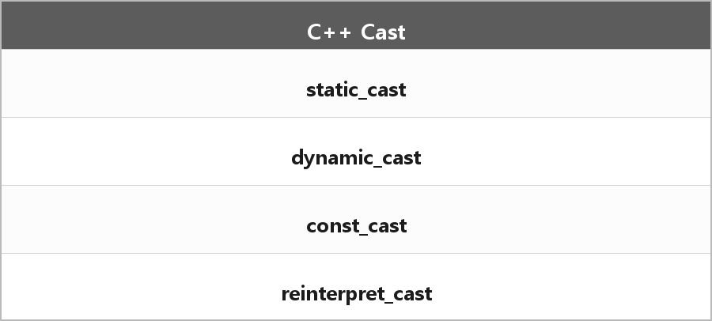

# C++ 캐스트 4가지

  

> C 스타일 `(Type)x`가 아니라 C++ 캐스트 네 개.

- static_cast: 관련 있는 타입 사이 일반 변환. 컴파일 타임.
- dynamic_cast: 다형 타입의 안전한 다운캐스트. 런타임에 확인하고 실패하면 포인터는 nullptr, 참조는 예외.
- const_cast: const/volatile을 붙이거나 뗀다. 원래 const인 객체를 수정하면 UB.
- reinterpret_cast: 비트 패턴/포인터를 다른 타입으로 재해석. 제일 위험하다.

---

> [!NOTE]
> **보충**
>
> - **출처:** C++ working draft [expr.static.cast], [expr.dynamic.cast], [expr.const.cast], [expr.reinterpret.cast]
> dynamic_cast가 동작하려면 대상에 가상 함수가 있어야 한다. 런타임 타입 정보가 그걸로 붙으니까.

---

> [!WARNING]
> **더 보충이 필요한 부분**
>
> 다중 상속에서의 dynamic_cast, cross-cast는 정리에 예시는 없다.
> 필요하면 [expr.dynamic.cast] 예시만 보고 한 개 추가하면 된다.
