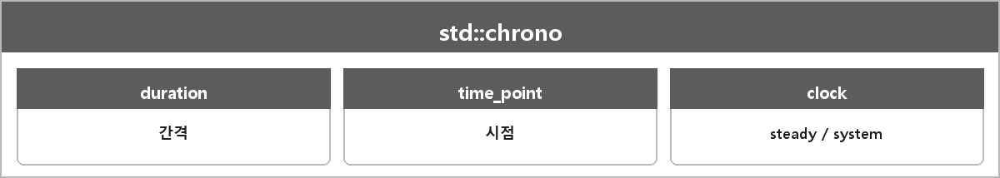

# std::chrono

  

> C++에서 시간을 단위가 붙은 타입으로 다루는 표준 라이브러리다.
>
> std::chrono는 시간 간격(duration), 시점(time_point), 시계(clock)를 분리해 단위가 명확한 연산을 제공한다.
>
> 경과 시간은 steady_clock으로 재고, 실제 날짜·시간은 system_clock으로 다룬다.
>
> 리터럴 10ms, 변환 duration_cast로 단위를 관리해서 델타타임, 타임아웃, FPS 제한을 구현한다.

---

> [!NOTE]
> **보충**
>
> - **출처:** C++ working draft [time]
> - duration: 틱 개수 + 주기
> - time_point: 어떤 clock의 epoch부터의 duration
> - steady_clock: 단조 증가. 벽시계 조정에 안 흔들린다. 프레임 간격 재는 용도.
> - system_clock: 실제 시각.
>
> deltaTime을 재려면 system_clock보다 steady_clock이 맞다. 사용자가 시계를 바꿔도 안 뒤로 가니까.
