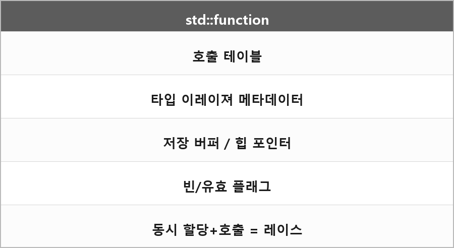

# std::function

  

> `std::function`은 내부적으로 여러 메모리 영역을 관리한다.
> 원자적이지 않다. 그래서 스레드로 같은 객체를 고치면서 호출하면 터진다.

## 내부가 들고 있는 것

| 칸 | 역할 |
| --- | --- |
| 1 | 함수 포인터 테이블 — vtable이랑 비슷한 거 |
| 2 | 타입 정보 — 타입 이레이져용 메타데이터 |
| 3 | 저장 공간 — 작은 객체용 내부 버퍼나 힙 포인터 |
| 4 | 형태 플래그 — 비어있음 / 유효함. 다이렉트할 때 렌더링 플래그 쓰던 그거 |

표준이 꼭 4칸이라고 정한 건 아니다. 구현 기준으로 이해한 그림이다.

## 왜 위험하냐

연산을 쪼갤 수가 없다. 할당 도중에 다른 스레드가 호출하면 끝이다.

### 할당 vs 호출

**스레드 A** — 새로운 람다 할당

1. 기존 함수 포인터 테이블 변경 시작
2. 새로운 타입 정보 설정 중

**스레드 B** — 같은 `std::function` 호출

1. 불완전한 상태의 테이블 접근
2. 잘못된 타입 정보로 호출

→ 크래시 또는 정의되지 않은 동작

말 그대로 할당 중에 호출된 거다.

### 스몰 버퍼 옵티마이제이션

**스레드 A** — 작은 람다 → 큰 람다로 교체

1. 힙 할당
2. 새 객체 생성
3. 포인터 교체
4. 기존 내부 버퍼 정리

**스레드 B** — 교체 중간에 호출

- 아직 유효하지 않은 힙 포인터
- 또는 이미 정리된 내부 버퍼

→ 메모리 접근 위반

## 내가 쓰는 보호

제일 쉬운 건 **커맨드 패턴**이다.

- 메시지 큐 — 안전한 통신
- 이벤트 버스

이렇게 쓰면 그나마 안전하다.

> 펑션은 문제가 실제로는 굉장히 특정한 타이밍에만 터진다.
>
> 나머지 시간엔 다른 로직이 잘 되는 것처럼 보인다.
> 디버깅하면 안 나타나는데 릴리즈에서 터진다?
>
> 바로~ 그냥 디버그 신사 ON.

---

> [!NOTE]
> **보충**
>
> - **출처:** C++ working draft `[func.wrap.func]` — 호출 가능한 객체를 한 타입으로 감싸는 래퍼
> - **출처:** `[intro.races]` — 한 스레드가 수정하고 다른 스레드가 읽거나 호출하면 데이터 레이스, 레이스는 UB
>
> 결론만 표준으로 말하면 **"같은 `std::function`을 동기화 없이 동시에 쓰고 고치지 마라"**다.
>
> Microsoft Learn `function` class 문서도 래퍼라고만 하지, 스레드 안전이라고 안 한다.
> 구현이 SBO를 쓰는 경우가 많아서, 교체 도중 크래시 시나리오는 그 구현 기준이다.
