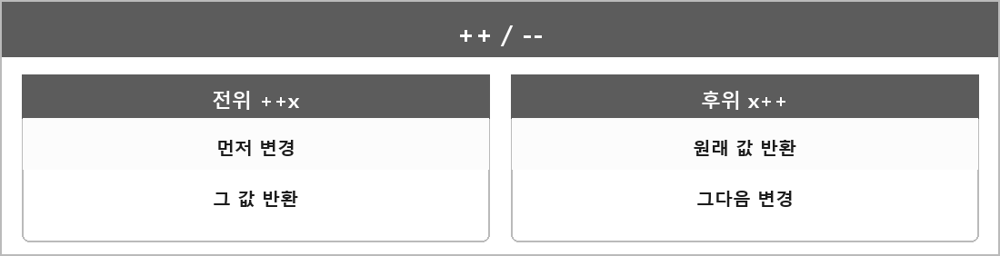

# 전위 / 후위 증감

  

> `++`, `--`를 쓸 때

- 전위: 값을 먼저 변경하고 반환한다.
- 후위: 값을 반환한 뒤 변경한다.

후위는 변경 전 값을 돌려줘야 해서 복사본이 생길 수 있다.
그래서 반환값을 안 쓰면 전위가 낫다.

---

> [!NOTE]
> **보충**
>
> - **출처:** C++ working draft [expr.pre.incr], [expr.post.incr]
> 내장 타입에서 전위는 증가한 lvalue, 후위는 증가 전 값의 prvalue다.
> 오버로드할 때도 후위는 더미 `int` 인자를 둔다. [over.inc]
