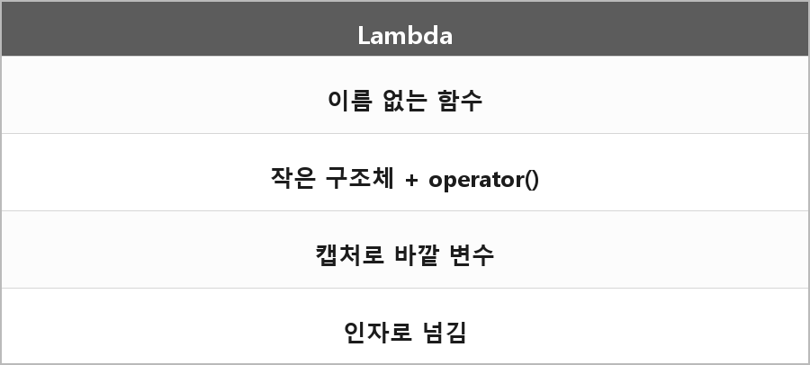

# 람다

  

> 간단히 말해 이름 없는 함수로 일회성으로 사용되거나 다른 함수의 인자값으로 넘겨줄 때 사용된다.
>
> 그냥 미지수 x와 같은 거다.
>
> 어떤 함수인 건데 그걸 내가 식 안에서 정의하는 거다.
>
> 바깥 변수를 캡처해서 내부에서 쓸 수 있는 거다.
>
> 고차 함수들에 간단한 동작을 넘길 때 많이 쓴다.
>
> 그냥 작은 구조체랑 오퍼레이터가 합쳐진 거라고 생각하면 된다.

---

> [!NOTE]
> **보충**
>
> - **출처:** C++ working draft [expr.prim.lambda]
> 람다 표현식은 클로저 타입의 prvalue를 만든다.
> 클로저 타입은 unique unnamed non-union class type이고, 호출 연산자를 가진다.
> 내가 적은 "작은 구조체 + operator()"가 표준이 말하는 그거다.
>
> 캡처는 클로저 객체의 멤버가 된다.
> `[]` 캡처 없음, `[=]` 복사, `[&]` 참조.

---

> [!WARNING]
> **더 보충이 필요한 부분**
>
> generic lambda (`auto` 매개변수), `mutable`, init-capture는 정리에 없다.
> 실제로 쓰기 시작하면 이 세 개가 바로 나온다.
> 필요하면 [expr.prim.lambda.capture]만 보고 최소로 추가하면 된다.
