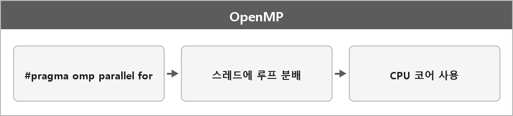

# OpenMP

  

> OpenMP는 공유 메모리 시스템에서 쓰레드 기반 병렬화를 간단한 지시문으로 제공하는 표준이다.
>
> 루프나 작업을 쓰레드에 자동 분배하고, 데이터 범위와 동기화를 명시해 경쟁 상태를 방지한다.
>
> 컴파일러 옵션만 추가하면 기존 코드에 최소 변경으로 가속할 수 있다.
>
> 그러니까 CPU의 멀티코어를 이용해서 병렬 프로그래밍을 위한 API다.

레이트레이싱 포트폴리오에 쓴 이유:
각 픽셀을 독립적으로 계산하기 때문에 병렬화 효율이 높고
OpenMP로 루프를 병렬화하면 CPU 코어를 모두 활용해 렌더링 시간을 줄일 수 있다.

---

> [!NOTE]
> **보충**
>
> - **출처:** OpenMP Architecture Review Board, OpenMP Specification (openmp.org)
> 공유 메모리 병렬 프로그래밍을 위한 API가 맞다. 지시문(#pragma omp), 라이브러리 루틴, 환경 변수로 구성된다.
> GPU 레이트레이싱 API가 아니라 CPU 스레드 병렬화다.
