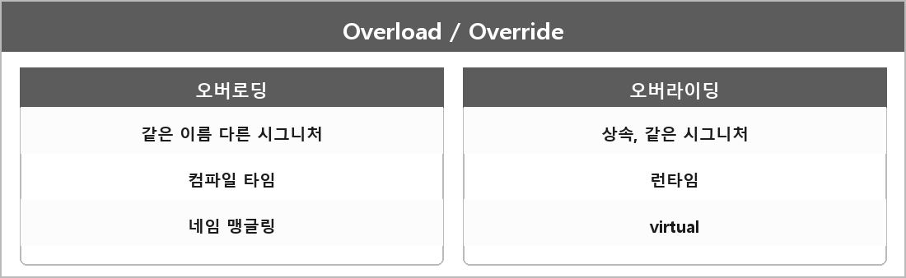

# 오버로딩 / 오버라이드

  

헷갈리기 쉬운 포인트부터.

| | 오버로딩 | 오버라이딩 |
| --- | --- | --- |
| 뭔가 | 같은 이름, **다른 시그니처** | 상속, **같은 시그니처** 재정의 |
| 언제 결정 | 컴파일 타임 (정적 바인딩) | 런타임 (동적 바인딩, virtual) |
| 구분 방법 | 네임 맹글링 | vtable |

## 오버로딩

같은 이름 메서드를 여러 번 정의하되, `const`가 붙거나 매개변수 타입·개수·순서가 다르게 한다.

컴파일러가 함수 이름을 고유하게 바꾼다. 그게 **네임 맹글링**이다.
이름 + 매개변수 타입 + const 여부를 합쳐서 링커에서 안 충돌나게 한다.
정적 다형성이다.

## 오버라이딩

상속 관계에서 부모 메서드를 자식이 재정의한다.
가상 함수로 선언된 부모 메서드를 자식에서 다시 쓰는 거다.
런타임에 객체의 실제 타입에 맞는 함수가 호출된다.

---

> [!NOTE]
> **보충**
>
> **출처:** C++ working draft
>
> - 오버로드 집합: `[over]`
> - 함수 시그니처: `[defns.signature]`, `[defns.signature.member]` (이름, 매개변수 타입, cv, ref-qualifier)
> - 가상 함수 오버라이드: `[class.virtual]`
>
> 네임 맹글링 형식은 표준이 안 정한다. Itanium C++ ABI / MSVC 몫이다.
> "링커가 구분하려고 이름을 바꾼다"는 이해는 맞다. 문자열 규칙까지 외울 필요는 없다.
>
> 반환 타입만 다른 오버로딩은 C++에서 안 된다. 시그니처에 반환 타입이 안 들어가서다.
