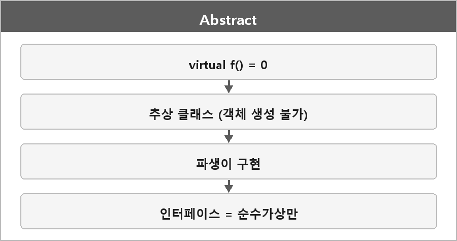

# 순수 가상함수 / 추상클래스 / 인터페이스

  

> 순수 가상 함수는 기본 클래스에서 선언만 하고 구현하지 않은 함수로, C++의 경우 `= 0`으로 선언된다.
>
> 이를 통해 기본 클래스는 추상 클래스가 된다.
>
> 추상 클래스는 객체를 직접 생성할 수 없고, 객체 생성을 위해선 파생 클래스에서 순수 가상 함수를 재정의해야 한다.
>
> 상속받는 클래스들이 공통된 메서드를 구현하게 해서 다형성을 지원한다.

---

## 추상클래스

기본적인 공통 기능과 인터페이스를 정의하는 클래스다.
구체적인 기능은 파생 클래스에서 구현한다.
부분적으로 구현된 함수와 순수 가상 함수를 함께 가질 수 있어서,
기본 동작은 제공하면서 구체적인 동작은 자식에서 구현하게 유도한다.

---

## 인터페이스

추상 클래스의 한 형태로 인터페이스가 있다.
모든 메서드가 순수 가상 함수로만 이루어져 있고, 멤버 변수는 가지지 않는 것이 일반적이다.
다양한 클래스가 공통된 메서드를 구현하게 하는 역할이고, 클래스들이 동일한 동작을 하도록 보장한다.
구현과 사용을 분리하고 결합도를 낮춘다.

C++에 interface 키워드는 없다. 관례로 순수 가상만 모은 클래스다.

---

> [!NOTE]
> **보충**
>
> - **출처:** C++ working draft [class.abstract]
> 순수 가상 함수가 있는 클래스는 추상 클래스다.
> 추상 클래스 타입의 객체는 만들 수 없다.
>
> 가상 함수는 실행 시점에 실제 객체 타입에 맞게 호출되는 함수고,
> 순수 가상 함수는 구현이 없어서 파생이 반드시 재정의해야 하는 함수다. (순수 가상도 정의는 제공할 수 있지만 그건 별 이슈)
