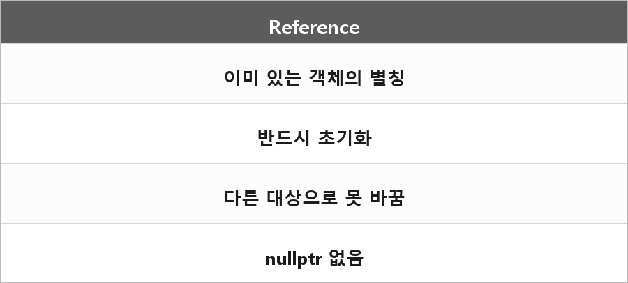

# 참조 (Reference)

  

> 이미 존재하는 변수나 객체에 붙이는 또 하나의 이름(별칭)

포인터랑 다른 점:
- 참조는 반드시 초기화된다
- 다른 대상을 가리키게 바꿀 수 없다
- nullptr이 없다

포인터는 주소를 저장하고 재할당이나 연산이 가능하고 nullptr도 될 수 있다.

---

> [!NOTE]
> **보충**
>
> - **출처:** C++ working draft [dcl.ref]
> 참조는 다른 객체나 함수의 별칭이다.
> 참조를 재좌석(reseating)하는 문법은 없다. 참조에 대입하면 별칭이 가리키는 객체를 대입하는 거다.

---

> [!WARNING]
> **더 보충이 필요한 부분**
>
> lvalue reference, rvalue reference, forwarding reference는 정리에 없다.
> 이동 의미론을 말하면 이 구분이 필요하다. 이유는 `T&&`가 문맥에 따라 의미가 달라서다.
> 필요하면 [dcl.ref], [dcl.type.decltype]을 보고 따로 적어야 한다.
