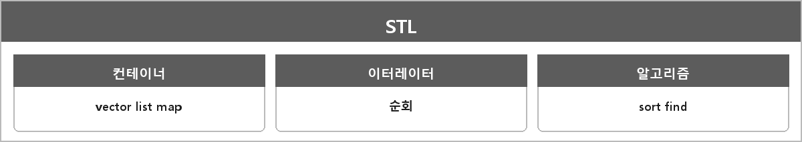

# STL

  

> C++ 표준 라이브러리로, 자료구조와 알고리즘을 효율적으로 사용할 수 있는 템플릿 기반의 라이브러리다. 주로 컨테이너, 이터레이터, 알고리즘으로 구성된다.

컨테이너는 데이터를 저장하는 구조로 벡터, 리스트, 셋, 맵 등이 있다.
이터레이터는 포인터와 유사한 객체로, 컨테이너의 요소를 순회하며 접근할 수 있게 한다.
알고리즘은 정렬, 검색, 변환 등의 연산을 제공한다.

일관된 인터페이스와 템플릿 기반이라 재사용이 된다.

---

> [!NOTE]
> **보충**
>
> - **출처:** C++ 표준 Clause [containers], [iterators], [algorithms]
> 지금 통칭 STL이라고 부르는 건 원래 HP/SGI STL에서 온 이름이고, 표준에선 C++ Standard Library다.
> 면접에선 STL이라고 해도 알아듣는다. 구성 세 덩어리(컨테이너/이터레이터/알고리즘) 이해면 충분하다.
>
> allocator, 실행 정책(C++17 parallel algorithms)은 정리에 없다. 지금은 안 적어도 된다.
