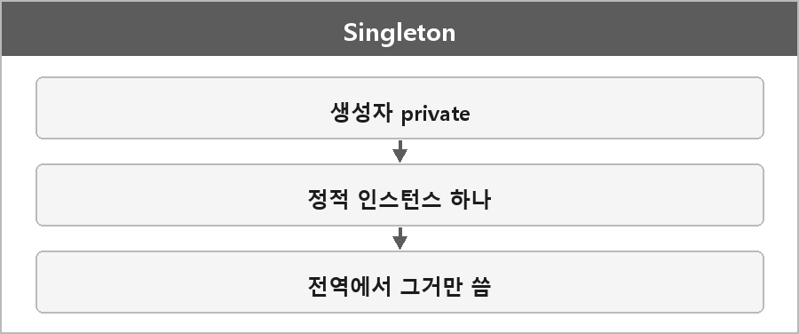

# 싱글톤

  

> 싱글톤 패턴은 클래스의 인스턴스를 단 하나만 유지하도록 보장하는 디자인 패턴이다.
>
> 주로 전역적으로 접근해야 하는 리소스를 관리할 때 쓴다.
>
> 설정 관리, 로깅, 게임 매니저 같은 경우. 정적 변수로 인스턴스를 저장하고, 외부에서 직접 생성하지 못하게 해서 유일한 인스턴스만 쓰게 한다.

의존성 주입이 어렵고 테스트가 힘들어질 수 있어서, 필요한 상황에서 신중하게 써야 한다.

C++로 만든다면 정적 지역 변수를 쓰는 Meyers Singleton이 제일 단순하다.
생성자, 복사, 대입을 막아서 하나만 유지한다.

게으른 초기화랑 같이 가는 경우가 많다. 처음 쓸 때 만든다.

---

> [!NOTE]
> **보충**
>
> - **출처:** C++ working draft [stmt.dcl]
> 블록 스코프 static 지역 변수 초기화는, 초기화가 동시에 여러 스레드에서 들어가도 한 번만 일어나도록 구현이 책임진다.
> 그래서 C++11 이후 Meyers Singleton이 스레드 안전 초기화로 많이 쓰인다.
> 패턴 이름 자체는 표준 용어가 아니라 GoF 디자인 패턴 쪽 용어다.

---

> [!WARNING]
> **더 보충이 필요한 부분**
>
> 소멸 순서(정적 객체 destruction order) 문제는 정리에 없다.
> 싱글톤끼리 소멸 시점에 서로를 건드리면 이미 죽은 객체를 건드릴 수 있다.
> 이유는 프로그램 종료 시 정적 저장 기간 객체 소멸 순서가 의존 관계랑 겹치기 때문이다.
> 필요하면 [basic.start.term]을 보고 한 줄 추가해야 한다.
