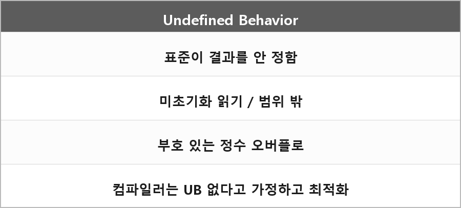

# Undefined Behavior (미정의 행동)

  

> 표준에서 어떤 결과도 명시하지 않은 경우.

### 결과

예측 불가능한 결과를 초래하며, 프로그램이 비정상적으로 동작하거나 충돌할 수 있다.

### 예시

초기화되지 않은 변수 읽기, 배열 범위를 벗어난 접근, 부호 있는 정수 오버플로.

컴파일러 최적화: 컴파일러는 미정의 행동이 발생하지 않는다고 가정하고 코드를 최적화한다.
이 때문에 최적화 레벨에 따라 프로그램의 동작이 달라질 수 있다.

---

> [!NOTE]
> **보충**
>
> - **출처:** C++ working draft [defns.undefined]
> undefined behavior = 이 문서가 아무 요구사항도 부과하지 않는 행동.
>
> 허용되는 결과는
> - 그냥 무시하고 예측 불가능한 결과
> - 그 환경에서 문서화된 방식으로 번역/실행 (진단 메시지를 낼 수도 있고 안 낼 수도 있음)
> - 번역이나 실행을 종료 (진단 메시지를 낼 수도 있음)
> 까지 다 들어간다.
>
> 내가 적은 "컴파일러는 UB가 안 난다고 가정하고 최적화한다"는 표준 문장 그대로는 아니지만, 그 결과로 실제로 일어나는 일이다.
> 표준이 결과를 안 정했으니까 컴파일러가 그 경로를 불가능하다고 접어도 표준 위반이 아니다.

---

> [!WARNING]
> **더 보충이 필요한 부분**
>
> C++26부터 일부 초기화 안 된 읽기는 erroneous behavior로 빠지기 시작했다.
> - **출처:** [defns.erroneous], [basic.indet]
> 면접에서 "무조건 UB"라고 단정하면 버전에 따라 틀린다.
> 지금은 "내가 쓰는 컴파일러/표준 버전에선 대부분 UB로 취급한다" 정도만 기억하고, C++26 세부는 나중에 표준 조항을 보고 다시 적어야 한다.
> 이유는 같은 코드가 표준 버전에 따라 분류가 바뀌기 때문이다.
