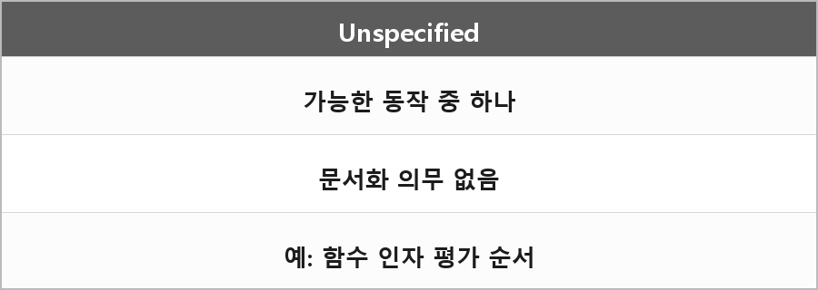

# Unspecified Behavior (명시되지 않은 행동)

  

> 표준에서 여러 가능한 동작 중 하나가 발생할 수 있다고만 명시하고, 어떤 동작이 선택될지는 명시하지 않은 경우.

### 결과

컴파일러는 유효한 범위 내에서 어떤 행동을 선택할 수 있지만, 반드시 문서화할 필요는 없다.

### 예시

함수 인자의 평가 순서 (`return p() + q() + r();`).

---

> [!NOTE]
> **보충**
>
> - **출처:** C++ working draft [defns.unspecified]
> unspecified behavior = well-formed 프로그램과 올바른 데이터에 대해 구현에 따라 달라지는 행동.
> 구현은 어떤 행동을 골랐는지 문서화할 의무가 없다.
> 가능한 범위는 보통 표준이 정해 둔다.
>
> 함수 호출에서 인자 평가 순서는 예전부터 이쪽 예시로 많이 쓴다.
> C++17 이후에는 인자끼리 indeterminately sequenced다. 섞여서 실행되진 않고, 누가 먼저인지만 정해지지 않는다.
> - **출처:** C++17 [expr.call]
>
> `p() + q() + r()`는 덧셈 결합 때문에 `(p() + q()) + r()`이지만, 피연산자 평가 순서를 인자 평가랑 같은 문장으로 묶으면 버전에 따라 말이 미묘하게 달라진다.
> 면접에선 "함수 인자 평가 순서는 unspecified"가 안전한 예시이고, `+`의 피연산자까지 한 묶음으로 단정하진 않는 게 맞다.

---

> [!WARNING]
> **더 보충이 필요한 부분**
>
> C++17 평가 순서 변경(P0145)을 조항별로 안 적었다.
> `<<`, `[]`, 대입 오른쪽-왼쪽 같은 건 순서가 정해진 게 있다.
> 이유는 예전 예시가 지금은 틀린 경우가 있어서다. 필요하면 [intro.execution], [expr.call]을 보고 연산자별로 다시 적어야 한다.
