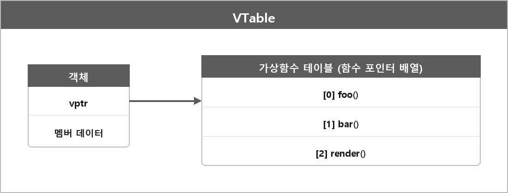

# 가상함수 테이블 (vtable)

  

> 가상함수 테이블은 C++에서 가상 함수의 호출을 지원하기 위해 사용되는 구조다.
>
> 클래스에 가상 함수가 포함되어 있을 때 컴파일러는 해당 클래스에 대한 가상 함수 테이블을 생성하고, 이 테이블은 가상 함수의 주소 목록을 저장한다.
>
> 객체가 가상 함수를 호출하면, 실제로는 객체의 vtable을 참조하여 올바른 함수가 호출되도록 한다.

테이블은 그냥 행과 열로 정리한 구조를 말하는 거다. 포인터의 배열인 거지, 그렇다고 선형 배열만은 아니다.
루트, 점프, 페이지 테이블 같은 테이블은 배열으로 쓰인다.
해시맵, 트리, 연결 리스트 형태일 때도 있다.
하지만 가상함수 테이블은 1차원 배열이 맞다.

구현을 대충 그리면:
- 객체 안에 vptr이 있다
- vptr이 그 클래스의 vtable을 가리킨다
- 가상 호출은 vtable[인덱스]를 호출한다

컴파일러가 실제 주소를 확정 못 하고 런타임 타입도 그 자리에서 모르는 이유는, 이 테이블을 런타임에 타기 때문이다.

---

> [!NOTE]
> **보충**
>
> vtable/vptr은 C++ 표준 용어가 아니다.
> Itanium C++ ABI 같은 구현 ABI 문서에서 레이아웃을 정한다.
> 단일 상속이면 함수 포인터 배열로 이해하는 게 맞다.
> 다중 상속, 가상 상속이면 테이블이 여러 개거나 thunk가 끼는 경우가 있다.

---

> [!WARNING]
> **더 보충이 필요한 부분**
>
> 다중 상속 vtable은 정리에 없다.
> 면접에서 "객체 앞에 vptr 하나"라고만 하면 다중 상속에서 틀린다.
> 필요하면 Itanium C++ ABI 2.5 Virtual Table Layout만 보고 최소로 보충하면 된다.
