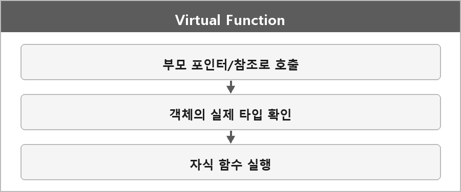

# 가상함수

  

> 가상 함수는 상속 관계에서 다형성을 지원하기 위해 사용하는 함수다.
>
> 부모 클래스에서 정의하고 자식 클래스에서 재정의할 수 있는 함수로, 동적 바인딩을 가능하게 한다.
>
> 기본 클래스의 포인터나 참조를 통해 자식 클래스의 함수를 호출할 수 있고, 런타임 시점에 객체의 실제 타입에 맞는 함수가 호출된다.
>
> 가상함수 테이블을 통해 런타임에 올바른 메서드가 호출되도록 한다.

순수 가상 함수는 기본 클래스에서 선언만 하고 구현하지 않은 함수로, C++에선 `= 0`으로 선언한다.
그 클래스는 추상 클래스가 되고 객체를 직접 못 만든다.
파생 클래스에서 재정의해야 객체를 만들 수 있다.
자세한 건 Pure-Virtual-Abstract-Interface.md에 있다.

---

> [!NOTE]
> **보충**
>
> - **출처:** C++ working draft [class.virtual]
> 가상 함수 호출은 객체의 동적 타입을 본다.
> vtable이라는 이름은 표준 용어가 아니다. 구현이 그렇게 만드는 경우가 많을 뿐이다.
> 표준은 "어떻게 구현하라"가 아니라 "어떤 함수가 호출돼야 한다"만 정한다.

---

> [!WARNING]
> **더 보충이 필요한 부분**
>
> 소멸자를 가상으로 두는 이유는 정리에 한 줄로도 없다.
> 기본 클래스 포인터로 delete할 때 파생 소멸자가 안 불리면 UB다.
> - **출처:** [class.dtor], [expr.delete]
> 면접에서 거의 같이 나오니까 나중에 그 조항만 보고 한 줄 추가해야 한다.
