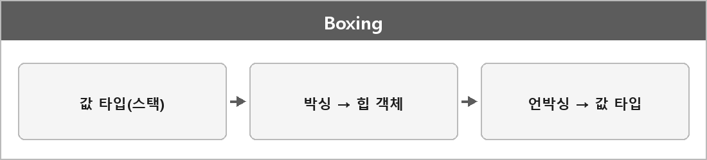

# 박싱 / 언박싱

  

> 값 타입 C#에서 구조체, 열거 타입 등은 값 타입이다. System.ValueType 로부터 항상 상속 스레드 스택에 할당이 된다.

참조 타입
C#에서는 모든 클래스는 참조 타입이 된다.
System.Object로부터 상속
힙에 저장이 되며 GC가 관리하게 된다.
이 힙 메모리의 주소를 가리키는 값은 스택에 저장이 된다.

박싱 : 값 타입을 참조 타입으로 변경
언박싱 : 참조 타입을 값 타입으로 변경

유니티에서 GC 스파이크 원인 중 하나가 박싱이다. object 매개변수, non-generic 컬렉션.

---

> [!NOTE]
> **보충**
>
> - **출처:** Microsoft Learn — Boxing and Unboxing
> 박싱은 값 타입 인스턴스를 Object 인스턴스로 변환하는 것. 힙에 객체가 생긴다.
> 언박싱은 그 반대. 타입이 안 맞으면 예외.
>
> 값 타입이 "항상 스택"은 단순화다. 클래스 필드면 그 객체랑 같이 힙에 있다.
> 지역 변수일 때 스택에 있다는 교육용 그림이다.
