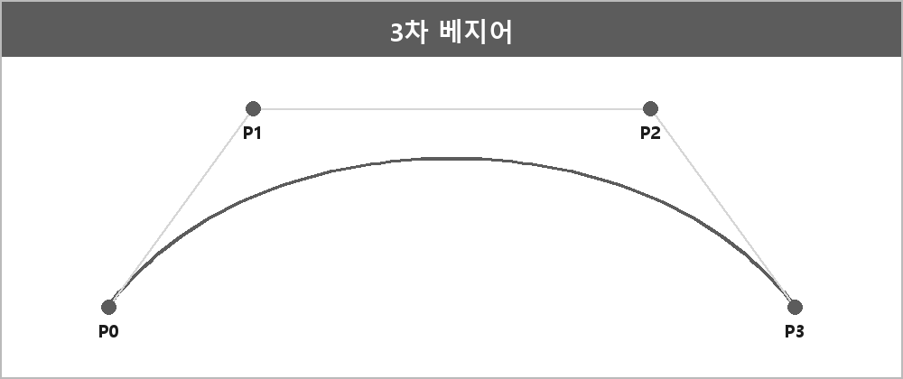

# 베지어 곡선

  

> 베지어 곡선은 제어점으로 정의되는 곡선으로, 2차는 3점으로 하나의 제어점이 곡선을 휘게 하고, 3차는 4점으로 두 제어점이 더 정교하게 제어한다.

3차 베지어 곡선은 4개의 조절점을 따라 보간하며 점을 찍고 계속 점을 찍으며 이동하는 것이다.
첫점과 끝점이 정해져 있고 두 조절점으로 매개변수 t값을 따라 보간하며 점진적으로 이동한다.

도끼, 비둘기, 부메랑 무기가 3차 베지어다.

---

> [!NOTE]
> **보충**
>
> - **출처:** 원 개념은 Pierre Bézier의 곡선. 수식은 de Casteljau algorithm이 표준 계산 방법.
> 3차: B(t) = (1-t)^3 P0 + 3(1-t)^2 t P1 + 3(1-t) t^2 P2 + t^3 P3, t in [0,1]

---

> [!WARNING]
> **더 보충이 필요한 부분**
>
> 2차 수식을 노트에 안 적었다. 면접이 2차/3차 둘 다 말하라면 2차도 같은 형태로 적어야 한다.
> 2차: (1-t)^2 P0 + 2(1-t)t P1 + t^2 P2
