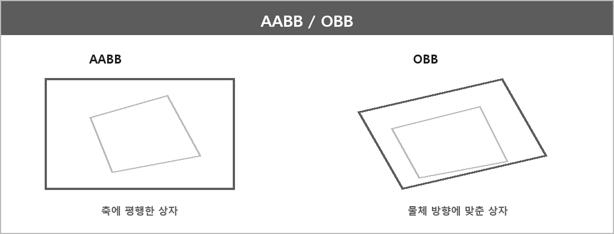

# BoundingBox (AABB, OBB)

  

> AABB는 바닥과 평행하게 상자를 놓은 것이고 OBB는 물체에 맞게 상자를 씌운 것이다.

AABB(최소 분리 벡터)
축별 간격을 비교한다.
X축: [ax_min, ax_max]와 [bx_min, bx_max]가 겹치면 OK, Y축도 같음
둘 다 겹치면 충돌, 하나라도 안 겹치면 비충돌
X축/Y축 침투량 중 더 작은 축 방향으로 밀어냄
방향은 두 박스 중심 비교해서 바깥쪽으로

OBB(분리 축 이론)
두 도형(볼록 다각형이나 볼록 다면체)이 겹치지 않는다는 것은, 어떤 직선(또는 축)에 두 도형을 정사영했을 때, 그 투영 구간이 겹치지 않는 경우가 있다는 뜻임
반대로, 만약 모든 검사해야 할 축에서 투영 구간이 겹친다면, 두 도형은 충돌하고 있다고 판정함

AABB는 축과 평행한 직육면체로, 충돌 검사 시 간단하고 계산 비용이 적다. 회전하지 않기 때문에 회전된 객체의 충돌을 제대로 표현하기 어려울 수 있다.
OBB는 임의의 각도로 회전할 수 있는 직육면체로, 객체의 회전과 방향에 맞춘 충돌 검사에 사용된다. 정확성은 높지만 AABB에 비해 계산 비용이 크다.

벽돌깨기, DirectX 프로젝트에서는 AABB로 충돌 판정했다.

---

> [!NOTE]
> **보충**
>
> 분리 축 정리(SAT)는 볼록 도형 충돌의 표준 방법이다.
> 원 논문급 출처: Gottschalk, Lin, Manocha 등의 OBB 충돌 논문 / Ericson, Real-Time Collision Detection.
> 볼록 집합이 분리되어 있으면 분리 초평면이 존재한다는 볼록 기하 성질이다.
>
> AABB 겹침 테스트는 축마다 구간 겹침이면 충분하다. 3D면 Z도 같다.
