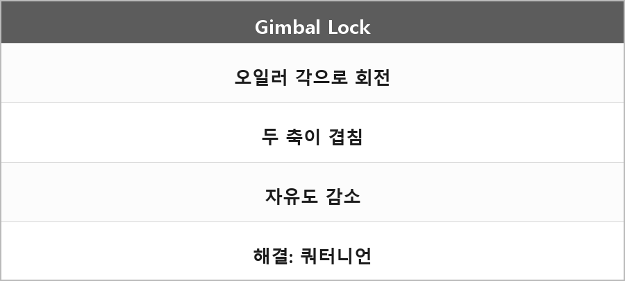

# 짐벌락

  

> 짐벌락은 오일러 각으로 회전을 표현할 때 두 축이 겹쳐 자유도가 줄어드는 현상이고, 쿼터니언이나 회전 행렬을 사용해 해결할 수 있다.

---

> [!WARNING]
> **더 보충이 필요한 부분**
>
> 왜 축이 겹치는지를 그림 없이 한 줄로만 적었다.
> pitch가 ±90도에 가까워지면 yaw/roll이 같은 회전이 된다.
> 보충하려면 오일러 각 회전 행렬 곱 순서를 공식으로 한 번 전개하거나, Unity/DirectXMath 쿼터니언 문서를 보고 "중간 축이 겹친다"를 예로 적어야 한다.
> 지금은 정의 + 해결(쿼터니언)만 있다.
