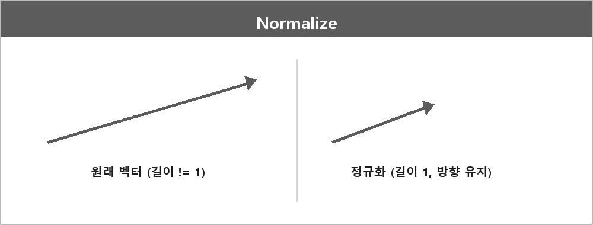

# 노멀라이즈 (벡터 정규화)

  

> 벡터의 정규화로 벡터의 크기를 1로 만드는 것이다.
>
> 주어진 벡터를 동일한 방향을 가지지만 크기가 1인 벡터로 변환하는 과정이다.
>
> 방향은 그대로인 채 크기를 표준화하여 이동방향, 충돌처리, 물리계산 등 다양한 용도로 사용된다.
>
> 원래 벡터를 자신의 길이로 나눈 것.

마우스 포지션을 정규화한다고 한 것도 이거다.
길이를 없애고 방향만 남긴다.
대각선 이동할 때 피타고라스 때문에 루트2가 되어 속도가 빨라지는 문제를 이렇게 막는다.

영벡터는 길이로 못 나눈다. 그 전에 길이 체크가 필요하다.
