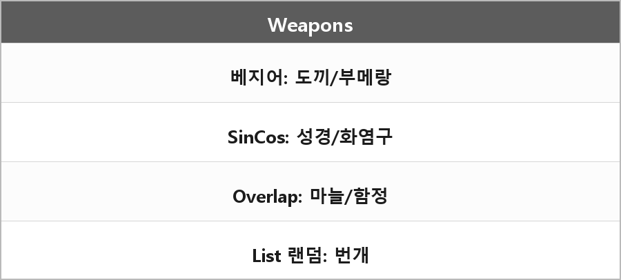

# 무기 구현 메모

  

> 도끼, 비둘기, 부메랑: 3차 베지어. Bezier.md.

성경, 화염구: Sin, Cos. 개수만큼 360도를 나눠 각도만큼 재배치. Aegis.md랑 같은 원 배치.

마늘: OverlapCircleAll
유도함정: OverlapBoxAll
둘 다 오버랩으로 일정 범위 내 콜라이더를 감지해서 피해를 주거나 그쪽으로 유도.

번개반지: List 이용.
현재 필드에 활성화되어 있는 적들을 GameMode_Manager의 Enemy_List에 넣고 List 중 랜덤으로 적을 선택해 그 위치에 번개를 소환.

룬트레이서: Reflect, WorldToViewportPoint. Reflect.md.

채찍: Scale을 바뀌는 방향에 맞추어 늘리기. 스케일 바꿨다고 하면 된다.
