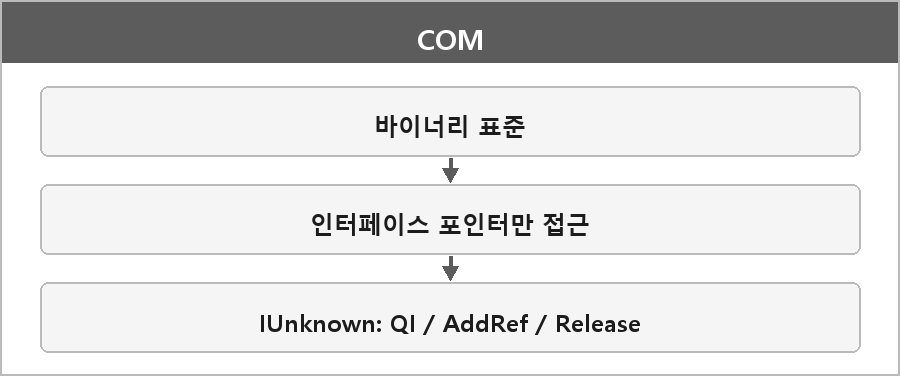

# COM

  

> Com Interface는 말 그대로 COM을 구현하기 위한 인터페이스다. 순수 가상 클래스라고 쉽게 말해서 유니티의 인터페이스랑 비슷한 거다.

Component Object Model의 준말인 COM은 언어, 플랫폼에 독립적인 이진 표준을 정의하여 해당 객체를 다른 프로그램이나 라이브러리에서 호출할 수 있도록 만드는 것.
언어, 플랫폼에 독립적인 이진 표준이란
컴파일된 코드 수준에서 그러니까 바이너리 코드 수준에서 서로 다른 운영체제나 언어가 이놈을 사용해도 호환될 수 있도록
규칙을 정해놓았단 말이다.

DirectX 디바이스, 스왑체인 같은 게 COM 객체다. ComPtr로 수명을 관리한다.

---

> [!NOTE]
> **보충**
>
> - **출처:** Microsoft Learn — The Component Object Model
> COM은 언어가 아니라 표준이다.
> 프로그램 구조까지 강제하지 않고, 바이너리로 번역된 뒤에 객체가 서로 대화하는 규칙을 정한다.
> 그래서 binary standard라고 부른다.
>
> 객체 데이터는 인터페이스(관련 함수 묶음)로만 접근하고, 인터페이스는 포인터로만 얻는다.
> 공통으로 IUnknown (QueryInterface, AddRef, Release)이 있다.
>
> 유니티 interface랑 "순수 가상 함수 표"라는 비유는 이해용이다.
> COM은 그 위에 참조 카운트랑 QueryInterface로 IID를 물어보는 바이너리 ABI가 붙는다.
> 같은 C++ 가상함수 테이블을 언어 간에 약속한 것에 가깝다.
