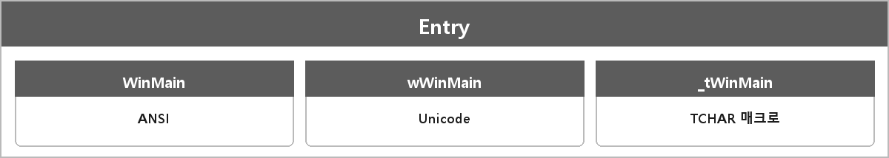

# WinMain / _tWinMain / wWinMain

  

> 포트폴리오에 wWinMain을 언급해서 대비하라고만 적혀 있다. 본문 차이는 없다.

---

> [!WARNING]
> **더 보충이 필요한 부분**
>
> 무엇: Windows GUI 엔트리 포인트 문자 집합 차이.
> 왜 필요: 본인이 포트폴리오에 적어 둬서 물어볼 수 있다고 함.
>
> 보충할 내용 (Microsoft Learn — WinMain, wWinMain, tchar.h):
> - WinMain: ANSI(CHAR) 커맨드라인
> - wWinMain: Unicode(WCHAR)
> - _tWinMain: TCHAR 매크로. UNICODE 정의에 따라 위 둘 중 하나
>
> CRT가 이 진입점을 부르는 건 CRT-Main.md.
> 지금은 공식 시그니처를 보고 세 줄로 채우면 된다.
